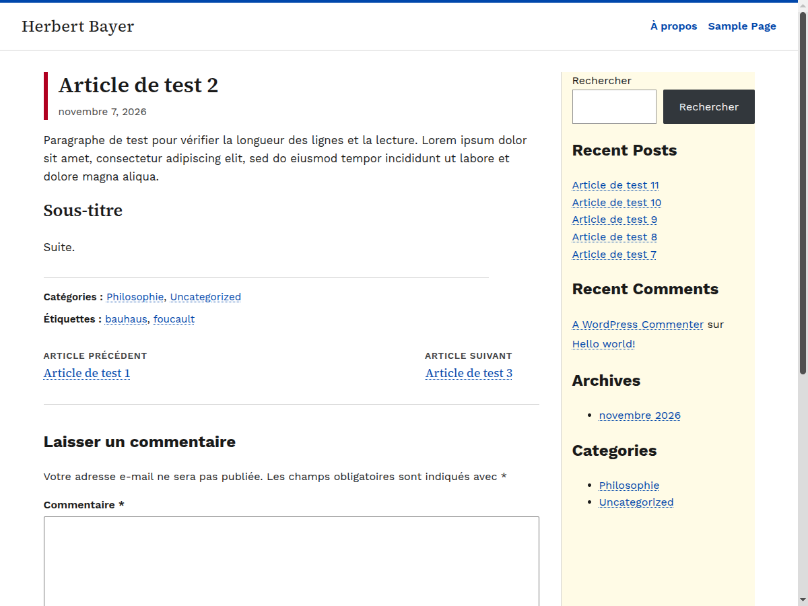

# Herbert Bayer

Thème WordPress classique d'inspiration Bauhaus, accessible (WCAG 2.1 AA) et sans JavaScript.

## Caractéristiques

- Thème classique (PHP), sans éditeur de site ni `theme.json`.
- Aucun JavaScript : menu et navigation utilisables sans script.
- Accessibilité visée : WCAG 2.1 AA (hiérarchie des titres, lien d'évitement, focus visible, contrastes vérifiés, textes cachés pour lecteurs d'écran).
- HTML sémantique : un seul `h1` par page, dates en `<time datetime>`, flux RSS déclarés.
- Typographie : Work Sans et Source Serif 4, chargées depuis [Bunny Fonts](https://fonts.bunny.net).
- Textes de l'interface en français.
- Un menu (« Menu principal ») et une barre latérale ; sans widget, la mise en page passe sur une colonne.
- Images à la une et intégrations responsives.

## Prérequis

- WordPress récent (testé avec l'image Docker officielle `wordpress`).
- PHP 7.4 ou plus (testé sous PHP 8).

## Installation

1. Télécharger `herbert-bayer-x.y.z.zip` depuis la page [Releases](https://github.com/scriptor-pro/herbert-bayer/releases).
2. Dans WordPress : *Apparence > Thèmes > Ajouter > Téléverser un thème*, choisir le fichier .zip, puis *Activer*.
3. Rattacher un menu à l'emplacement « Menu principal » (*Apparence > Menus*).

Réglage conseillé : format de date `j F Y` (*Réglages > Général*).

## Limites connues

- Les titres des widgets en blocs n'utilisent pas la police serif du thème.
- Le bouton du widget de recherche en blocs garde le style de WordPress.
- Pas encore testé avec un lecteur d'écran ni mesuré avec Lighthouse.

## Licence

GNU General Public License v2 ou ultérieure. Voir [LICENSE](LICENSE).

Auteur : Baudouin — [somebaudy.com](https://somebaudy.com)
